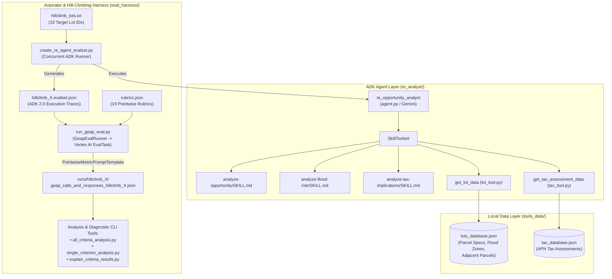

# Autoraters & Hill-Climbing Automation for ADK Agents (`re_analyst`)

Complete step-by-step documentation, system architecture, and evaluation results for the **Real Estate Investment Opportunity Analysis Agent (`re_analyst`)** evaluated using the **Vertex AI GenAI Evaluation Service (GEAP)**.

---

## 1. Executive Summary

This project implements an end-to-end **Autorater Evaluation & Hill-Climbing Harness** for an Agent Development Kit (ADK) agent (`re_analyst`) that generates real estate site evaluation memorandums for candidate land parcels:

1. **Task 1 — Statistical Autorater Criteria Analysis (Inter-Rater Reliability)**:
   - Evaluated 19 candidate rubric criteria across multiple stochastic LLM-as-a-Judge passes ($k$-passes) using summary statistics, pairwise percent agreement, and **Krippendorff's Alpha ($\alpha$)**.
   - Identified high-reliability, discriminative criteria and saved the top selections in `best_criteria_submission.txt`.
2. **Task 2 — Automated Hill-Climbing Loop**:
   - Executed baseline evaluation (`hillclimb_1`) on 10 target edge-case properties (`LOT-8472`, `LOT-8471`, `LOT-8473`, `LOT-1000`–`LOT-1006`) for two target criteria: **`cost-per-acre`** (baseline mean: `1.6000`) and **`neighboring-flood-risk`** (baseline mean: `1.0000`).
   - Diagnosed agent deficiencies using `explain_criteria_results.py` and `rubrics.json`.
   - Upgraded the agent's modular ADK skills (`analyze-opportunity`, `analyze-flood-risk`, `analyze-tax-implications`) to explicitly compute/benchmark acquisition cost-per-acre and recursively inspect adjacent parcels (`adjacent_parcels`) via `get_lot_data` for cross-boundary hydrological and flood zone risks.
   - Re-ran `run_hillclimb.py` (`hillclimb_2`), achieving a **perfect `5.0000` mean score** on both target criteria.

---

## 2. System & Evaluation Architecture



### Key Components
| Component | Path | Responsibility |
| :--- | :--- | :--- |
| **Root ADK Agent** | `re_analyst/agent.py` | Configures `re_opportunity_analyst` with `SkillToolset` and standardized memorandum instructions. |
| **Opportunity Skill** | `re_analyst/skills/analyze-opportunity/SKILL.md` | Orchestrates parcel lookup, adjacent parcel retrieval, and **Acquisition Cost-Per-Acre** calculation/benchmarking. |
| **Flood Risk Skill** | `re_analyst/skills/analyze-flood-risk/SKILL.md` | Inspects subject and neighboring parcel FEMA flood zones (`adjacent_parcels`), grade slopes, soils, and shared hydrological runoff impacts. |
| **Tax Skill** | `re_analyst/skills/analyze-tax-implications/SKILL.md` | Retrieves APN tax assessments, computes monthly tax carrying costs (`Annual Tax / 12`), and benchmarks land cost basis. |
| **EvalSet Builder** | `eval_harness/create_re_agent_evalset.py` | Runs the ADK agent concurrently (`asyncio.Semaphore`) over target Lot IDs and exports ADK 2.0 `.evalset.json` traces. |
| **GEAP Eval Runner** | `eval_harness/run_geap_eval.py` | Extracts `finalResponse` text from ADK traces, builds Vertex AI `PointwiseMetricPromptTemplate`s from `rubrics.json`, and runs `EvalTask`. |
| **Hill-Climb Runner** | `eval_harness/run_hillclimb.py` | Automates trace generation + `k=1` GEAP evaluation for `cost-per-acre` and `neighboring-flood-risk` into versioned `runs/hillclimb_X/` folders. |
| **Criteria Analytics** | `eval_harness/all_criteria_analysis.py`, `single_criterion_analysis.py`, `explain_criteria_results.py` | Computes Mean, StdDev, Pairwise Agreement, Krippendorff's $\alpha$, N×k grade matrices, and judge rationales. |

---

## 3. Step-by-Step Commands for Each Task

### Environment Setup
```bash
cd ~/autoraters
cat .env
```

---

### Task 1: Evaluate Autorater Criteria & Inter-Rater Reliability

#### Step 1.1: Analyze All Criteria Across Multi-Pass GEAP Logs
Compute summary statistics, pairwise agreement, and Krippendorff's Alpha ($\alpha$) across all 19 criteria from the multi-pass evaluation dataset:
```bash
cd ~/autoraters
python3 -m eval_harness.all_criteria_analysis \
   --run_geap_eval_out runs/geap_calls_and_responses_for_analysis.json
```

#### Step 1.2: Inspect Individual Criteria Grade Matrices ($N \times k$)
Inspect detailed per-lot, per-pass rating matrices and agreement metrics for specific criteria:
```bash
cd ~/autoraters
python3 -m eval_harness.single_criterion_analysis \
   --run_geap_eval_out runs/geap_calls_and_responses_for_analysis.json \
   --criterion neighboring-flood-risk

python3 -m eval_harness.single_criterion_analysis \
   --run_geap_eval_out runs/geap_calls_and_responses_for_analysis.json \
   --criterion flood-zone-flagging

python3 -m eval_harness.single_criterion_analysis \
   --run_geap_eval_out runs/geap_calls_and_responses_for_analysis.json \
   --criterion environmental-esa
```

#### Step 1.3: Record Best Criteria Submission
Save the selected criteria IDs into `best_criteria_submission.txt`:
```bash
echo -n "neighboring-flood-risk,flood-zone-flagging,environmental-esa" > ~/autoraters/best_criteria_submission.txt
cat ~/autoraters/best_criteria_submission.txt
```

---

### Task 2: Perform Hill-Climbing Automation

#### Step 2.1: Run Baseline Hill-Climbing Evaluation (`hillclimb_1`)
Run the agent over the 10 target lots in `eval_harness/hillclimb_lots.txt` and evaluate `cost-per-acre` and `neighboring-flood-risk`:
```bash
cd ~/autoraters
python3 -m eval_harness.run_hillclimb
```
*Baseline (`hillclimb_1`) Results:*
- `cost-per-acre` Mean Score: **`1.6000`**
- `neighboring-flood-risk` Mean Score: **`1.0000`**

#### Step 2.2: Analyze the Hill-Climbing Results (`explain_criteria_results.py`)
Inspect the Gemini judge's detailed grading rationales for all lots scoring $\le 4.0$:
```bash
cd ~/autoraters

# Inspect rationales for cost-per-acre
python3 -m eval_harness.explain_criteria_results \
   --run_geap_eval_out runs/hillclimb_1/geap_calls_and_responses_hillclimb_1.json \
   --criterion cost-per-acre \
   --max_score_to_show 4.0

# Inspect rationales for neighboring-flood-risk
python3 -m eval_harness.explain_criteria_results \
   --run_geap_eval_out runs/hillclimb_1/geap_calls_and_responses_hillclimb_1.json \
   --criterion neighboring-flood-risk \
   --max_score_to_show 4.0
```

**Root Causes Identified:**
1. **`cost-per-acre`**: The baseline skills noted `last_sale_price` and `acreage` separately but never instructed the agent to compute `Last Sale Price / Acreage`, display the explicit derivation formula, or benchmark/highlight it as a core valuation metric (required for Score 5 in `eval_harness/rubrics.json`).
2. **`neighboring-flood-risk`**: The baseline `analyze-flood-risk` skill only checked `flood_zone` on the subject parcel and never instructed the agent to look up `adjacent_parcels` via `get_lot_data` or analyze cross-parcel drainage, slope runoff, and shared hydrological impacts (required for Score 5 in `eval_harness/rubrics.json`).

#### Step 2.3: Improve Agent Skills & Re-run Hill-Climbing (`hillclimb_2`)
After updating:
- `re_analyst/skills/analyze-opportunity/SKILL.md`
- `re_analyst/skills/analyze-flood-risk/SKILL.md`
- `re_analyst/skills/analyze-tax-implications/SKILL.md`

Execute the hill-climbing harness again:
```bash
cd ~/autoraters
python3 -m eval_harness.run_hillclimb
```

*Iteration 2 (`hillclimb_2`) Results:*
```text
=========================================
📊 Hill Climbing Results: hillclimb_2
=========================================
 • cost-per-acre             Mean Score: 5.0000
 • neighboring-flood-risk    Mean Score: 5.0000
=========================================
```

Verify that no properties scored $\le 4.0$ in `hillclimb_2`:
```bash
cd ~/autoraters
python3 -m eval_harness.explain_criteria_results \
   --run_geap_eval_out runs/hillclimb_2/geap_calls_and_responses_hillclimb_2.json \
   --criterion cost-per-acre \
   --max_score_to_show 4.0

python3 -m eval_harness.explain_criteria_results \
   --run_geap_eval_out runs/hillclimb_2/geap_calls_and_responses_hillclimb_2.json \
   --criterion neighboring-flood-risk \
   --max_score_to_show 4.0
```
*(All 10 properties scored `5.0` on both criteria.)*
